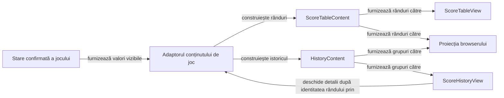

# Widgeturi pentru scor și istoric derulabil

## Pe scurt

Jocul proiectează valorile vizibile confirmate; biblioteca le afișează. Etichetele coloanelor, semnele scorurilor, ordinea jucătorilor, identitățile rândurilor și acțiunile detaliilor rămân intrări ale consumatorului. Widgeturile nu calculează puncte și nu decid câștigătorul.

Legendă

- Adaptorul jocului deține valorile confirmate și identitățile rândurilor; widgeturile Android și browserul consumă același conținut neutru.
- Callback-ul detaliilor întoarce identitatea rândului către adaptor. Widgeturile nu modifică jocul și nu calculează puncte.

## Contracte

| Contract | Responsabilitate |
|---|---|
| `ScoreTableContent` | Coloane imuabile cu ponderi și aliniere numerică, rânduri stabile, evidențiere și subliniere opționale. |
| `HistoryContent` | Grupuri imuabile de jucători, etichete furnizate de consumator, antete de rând fixate, legendă și descrieri accesibile. Identitățile duplicate și celulele nealiniate sunt refuzate înaintea afișării. Istoricul gol este valid. |
| `ScoreTableView` | Paleta și dimensiunile rândurilor din `ScoreGridStyle`; valorile, alinierea și evidențierea rândurilor vin din adaptor. |
| `ScoreHistoryView` | Etichete fixate, antete și valori sincronizate orizontal, rânduri aliniate vertical și afișare lizibilă în ferestre joase. Consumatorul poate furniza propriile identități accesibile prin accessorii panourilor. |
| `HistoryGridMetrics` | Măsurători în pixeli furnizate de platformă; minimele numerice rămân complete, spațiul suplimentar este distribuit, iar depășirea rămâne derulabilă. |
| `HistoryScrollSync` | Sincronizare bidirecțională fără bucle de reacție; eșecul unei ținte nu blochează derulările ulterioare. |

View-ul Android măsoară textul real. Fixture-urile JVM acoperă ferestre compacte și late, densități fracționare, fonturi mărite, ultimul jucător și ultimul rând. Ele califică măsurarea și politica evenimentelor; rasterul nativ, focusul accesibil și gesturile cer acceptanță separată pe platformă.

## Integrarea consumatorului

Creați conținutul dintr-un snapshot confirmat, furnizați un callback bazat pe identitatea stabilă a rândului și păstrați navigarea și persistența în afara widgetului. Adaptoarele browserului compilează aceleași clase portabile și le traduc în protocolul rendererului. Capacitatea coloanelor din browser trebuie verificată explicit înaintea adoptării altei familii de coloane.

[Frontiera modulului și împachetare](../../../../../../../README.md) · [Strategia de componente](../../../../../../../../../docs/testing/README.md)
