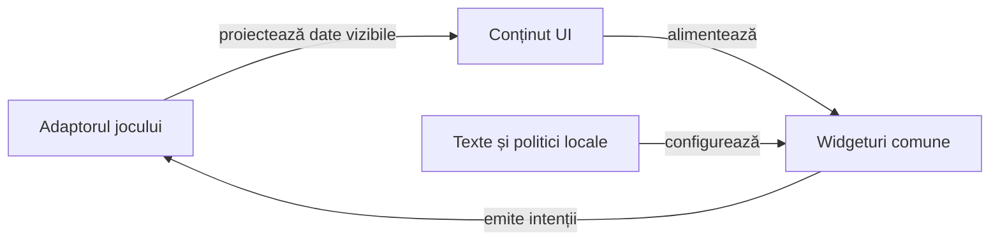

# Nucleul comun al interfeței pentru jocuri de cărți

## Pe scurt

Modulul Android Library extrage componente vizuale din aplicația Whist, păstrând desenul și contractele lor. Publică un AAR pentru meniul de pornire, editorul numelui, widgeturi, tema Android, chenarele jucătorilor, geometria mesei, mâna și cărțile depuse; jocurile furnizează textele, preferințele, fereastra și comenzile.

## Responsabilități și limite

| Pachet | Contract implementat |
|---|---|
| [screens](src/main/java/ro/cardtable/ui/screens/ScreenViews.java) | Aceiași constructori de pagini, texte, butoane și selectori; eticheta selectorului și protecția ferestrei sunt porturi furnizate de aplicație. |
| [menu](src/main/java/ro/cardtable/ui/menu/HomeMenuContent.java) | Ordine, etichete, tag-uri, stare de reluare și callback-uri; dropdown-ul păstrează cele două limbi și înregistrarea amânată a listenerului. |
| [profile](src/main/java/ro/cardtable/ui/profile/NameEdit.java) | Dialogul și ruta salvare/resetare; normalizarea, persistența și excepția originală aparțin consumatorului. |
| [cards](src/main/java/ro/cardtable/ui/cards/CardFace.java) | Numai însemne vizibile, proporția cărții și desenul comun; validitatea rangului și informația privată rămân în motor. |
| [hand](src/main/java/ro/cardtable/ui/hand/HandLayoutMetrics.java) | Geometrie, centrare/derulare și rendererul `HandFan`; `HandCard` furnizează numai identitate, însemne, accesibilitate și interactivitate. |
| [seat](src/main/java/ro/cardtable/ui/seat/SeatContent.java) | Nume, fapte ordonate și actor activ furnizate de joc; cadrul și regiunea indicatorului sunt măsurate identic cu reperul Whist. |
| [table](src/main/java/ro/cardtable/ui/table/BoardLayout.java) | Regiuni ocupate, ordine vizuală, viewport și cărți publice poziționate după loc; conținutul centrului aparține consumatorului. |
| [turn](src/main/java/ro/cardtable/ui/turn/TurnPacing.java) | Așteaptă primul cadru vizibil, aplică intervalul comun și invalidează acțiunea dacă scena s-a schimbat. |
| [theme](src/main/java/ro/cardtable/ui/theme/TablePalette.java) și [widgets](src/main/java/ro/cardtable/ui/widgets/DropdownBackground.java) | Culori, chenare și desenul selectorului. |

Aplicația deține compoziția mesei, regulile, istoricul, câștigătorul și momentul afișării levatei. Biblioteca măsoară fețele și chenarul câștigător, apoi aplică mișcarea. Contractul comun folosește numai locuri și date vizibile.

`CardTableTheme` păstrează cele șase atribute Android ale reperului; `AppTheme` Whist este aliasul acestei resurse. Consumatorul o adoptă explicit în manifest; admiterea AAR-ului și build-ul nu declară comparație de pixeli sau focus Android.



<details>
<summary>Legendă: componente comune și proprietarul partidei</summary>

Proiecțiile nu calculează reguli. Aplicația validează comanda, păstrează preferințele și gestionează lifecycle-ul; biblioteca redă datele permise și trimite callback-ul asociat controlului.

</details>

## Integrarea existentă Whist

- Aplicația consumă modulul prin `implementation project(':card-table-ui')`.
- `WhistMenuContent` proiectează textul real; `MenuScreens` păstrează navigarea, configurarea și instrucțiunile jocului.
- `PlayerSettingsDialog` păstrează `PlayerNames` și callback-ul de salvare; dialogul comun nu mută preferințele sau partida.
- Fațadele existente pentru geometrie, temă și desen delegă implementării comune, păstrând tipurile folosite de aplicație și testele sale. `WhistCardFace` proiectează cartea domeniului înaintea desenului.

Fațadele sunt adaptoare de compatibilitate, cu o singură implementare a algoritmului în bibliotecă. Eliminarea lor cere migrarea explicită a apelanților și păstrarea inventarului de teste.

## Verificare

Din copia temporară a rădăcinii Android `whist-lab-app`, în PowerShell 7, cu JDK 21, SDK Android și cache-ul Gradle pregătit:

```powershell
.\gradlew.bat --offline --no-daemon :card-table-ui:testDebugUnitTest :app:testDebugUnitTest --tests ro.whistlab.app.screens.WhistMenuContentComponentTest --tests ro.whistlab.app.cards.WhistCardFaceComponentTest --tests ro.whistlab.app.table.content.*
```

| Selecție | Așteptare independentă |
|---|---|
| Meniul comun | Ordine și tag-uri fixe, RO/EN, nume implicit/configurat, reluare dezactivată și callback-uri distincte. |
| Editarea numelui | Ordinea validare/salvare, identitatea erorii, refuz fără scriere și resetare fără validarea numelui gol. |
| Geometria mâinii | Dimensiuni istorice, o carte centrată, extreme și indici măsurați; parametri nevalizi refuzați. |
| Frontiera bibliotecii | Inventar nevid; producția și testele comune nu importă motoare, sesiuni sau reguli ale consumatorilor. Fără stocare, activitate ori permisiuni proprii. |
| Modele de masă | Identități stabile, fapte ordonate și imuabile, regiuni măsurate și dimensiuni identice indiferent de numărul locurilor. |
| Temporizarea turei automate | `TurnPacingComponentTest` verifică randarea înaintea întârzierii de 550 ms, acțiune unică și anulare pentru actor uman, blocaj sau scenă înlocuită. |
| Adaptoarele Whist | Textele reale, limba, callback-urile și însemnele tuturor cărților. |

Componentele existente de masă și mână rămân verificări de integrare, cu aserțiunile lor păstrate. Comparația cu snapshot-ul anterior și inspecția corpurilor de desen califică refactorizarea; pixelii, focusul și atingerea Android cer sanity nativ distinct.

## Separarea jocurilor și a componentelor

| Proprietar | Responsabilitate și teste |
|---|---|
| Biblioteca comună | Desen, măsurare, centrare, chenare, fapte afișate și mecanica widgeturilor; fără oracole de joc. |
| Whist | `WhistTableContent`, configurație, legalitate, licitație, atu, punctaj și lifecycle; componentele existente cu motor rămân în aplicația Whist, cu așteptările originale. |
| Rentz | Adaptor propriu pentru observația Rentz, alegere/reveal, pas, secvențe și punctaj. Datele de scor nu sunt convertite în licitat sau levate fictive. |
| Alt consumator de joc de cărți | Consumator Android; păstrează regulile, sesiunea, checkpoint-ul și decizia în motorul propriu, apoi folosește cadrul activ, pacing-ul după primul cadru și geometria comună a mișcării. |

- Ordinea vizuală pentru 3–6 locuri păstrează omul la indicele zero; adaptorul deține maparea stabilă spre identitățile motorului și actorul real.
- `SeatContent.Fact` păstrează textul și ordinea; biblioteca nu adună puncte, nu interpretează valori negative și nu decide câștigătorul.
- `HandCard` nu conține mâini adverse sau comenzi. Adaptorul proiectează numai informația vizibilă și rezolvă identitatea selectată în snapshot-ul afișat.
- `PlayedCardsView` este prezentarea depunerilor pe locuri. Tabla de secvențe Rentz și viitoarele cărți comunitare Hold'em sunt compoziții distincte ale centrului.

[Calificarea extragerii mesei](../../../../whist_back/ui-extraction/a4c96eeb71/README.md) identifică reperul Whist și separă rezultatele de componentă, admiterea Rentz și verificarea raportului de acceptanța nativă.

## Împachetare și consum

Tot din copia temporară, cu destinația Maven externă explicită:

```powershell
.\gradlew.bat --offline --no-daemon :card-table-ui:publishReleasePublicationToIsolatedRepository -Pcardui.repository=<repository-extern>
```

- Coordonata este `ro.cardtable:card-table-ui:0.1.7`. Exportul conține AAR, POM, metadata Gradle și surse.
- [Politica de nume](../card-table-names/README.md) se publică separat ca JAR Java, pentru motoare și probe JVM.

## Levata și informația din chenar

- `CollectionTarget` primește locurile cărților publice și locul câștigător calculat în joc. `TrickCollectionMotion` păstrează fereastra de 1500 ms și folosește ultimele 500 ms pentru colectare.
- `TrickCollectionRun` deține geometria, ciclul de viață și curățarea. Adaptorul Android caută fețele cărților și chenarul prin identitatea locului. Whist păstrează validarea snapshotului și momentul când publică levata.
- Cadrele Android folosesc ceasul monoton. Un callback întârziat sare la poziția corespunzătoare timpului scurs, iar un callback după termen termină mișcarea.
- Whist și Rentz folosesc `PlayerSeatFrame.buildInlineFacts`. Numele și cele două rânduri își păstrează textul integral și înălțimea, iar lățimea se adaptează după măsurarea finală a glifelor Android.
- [Componenta nativă a chenarului](src/androidTest/README.md) verifică 36 de combinații. Include 3–6 locuri, lățimi de 240/320/393 dp, font 1/1,5/2, diacritice și valori semnate lungi, inclusiv Δ și Σ.
- Biblioteca păstrează `minSdk 24`, compilare SDK 36 și Java 17. Consumatorul deține pachetul instalabil, versiunea și semnarea APK-ului.
- POM-ul păstrează runtime-ul Kotlin adăugat automat de toolchain, deja prezent în aplicația reper. [Kotlin integrat în AGP](https://developer.android.com/build/migrate-to-built-in-kotlin) și [dependența standard](https://kotlinlang.org/docs/gradle-configure-project.html) explică această contribuție.
- Admiterea confruntă SHA-256, conținutul AAR, manifestul și dependențele înaintea build-ului consumatorului. Publicarea locală nu închide acceptanța UI în alt joc.

[Aplicația Whist](../app/src/main/java/ro/whistlab/app/README.md) · [Strategia componentelor](../../docs/testing/ATF_DisplayComponents.md) · [Extragerea rămasă](../../docs/feedback/ATF_CardUi_Extraction.md)
