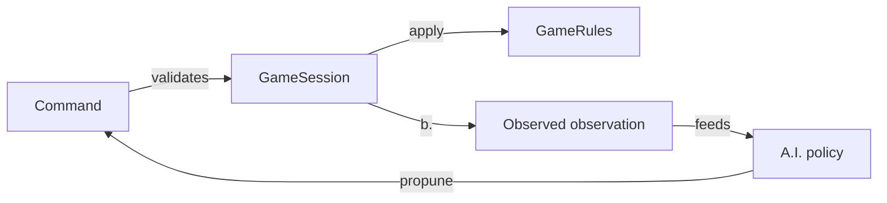

# Whist Rules Engine

## Overview

Java engine holds configuration, rules, transitions, score history and game policy. The Android application and JVM environment consume the same sources; production remains independent of Android, ATF and JUnit.

The tests check the field through independent properties and oracles. [Intrarea JVM](../algorithm-build/README.md) allows offline work, and [Variant Guide](../../docs/game/README.md) has the full explanation of the rules.

- [Laboratorul AI](../ai-lab/README.md) is Gradle's dependency only for tests. Independent policy shall be compiled in its module; the distribution of the engine shall only retain its own production sources.

## Domain flow



<details>
<summary>Legend: status of the session and actor's observation</summary>

The session retains the complete status required for the game and restoration. The [AiPolicy](src/main/java/ro/whistlab/core/ai/policy/AiPolicy.java) facade builds the policy observation through the observation adapters: own hand and public information. The full distribution used by the session and audit shall not become input into the decision algorithm.

</details>

## Contracts in code

| Area | Responsibility |
|---|---|
| [GameConfig](src/main/java/ro/whistlab/core/config/GameConfig.java) | Number of players, variant, level, initialization and series configuration. |
| [GameRules](src/main/java/ro/whistlab/core/rules/GameRules.java) | Package, program, offers and legal cards, winner and baseline score. |
| [RomanianScoring](src/main/java/ro/whistlab/core/rules/RomanianScoring.java) | Contract points and series evolution. |
| [GameSession](src/main/java/ro/whistlab/core/session/GameSession.java) | The front of the controls, the rotation between the hands and the publication of the match status. |
| [HandPlay](src/main/java/ro/whistlab/core/session/HandPlay.java) | Distribution, bids, order of the moves and the public history of the current hand. |
| [PlayerScore](src/main/java/ro/whistlab/core/session/scoring/PlayerScore.java) | Calculate a player's balance and series when closing his hand. |
| [SessionCheckpoint](src/main/java/ro/whistlab/core/session/SessionCheckpoint.java) | Capture the rescue contract and rebuild the status after validation. |
| [ScoreHistory](src/main/java/ro/whistlab/core/session/ScoreHistory.java) | Bidding, known tricks and balances of hands are the difference between balances. |
| [HowToPlay](src/main/java/ro/whistlab/core/rules/HowToPlay.java) | Aid RO/EN for the selected profile and programme. |

## Romanian Whist

Profile accepted 3–6 players and a reduced pack of `8 × N` Big cards. [GameMode](src/main/java/ro/whistlab/core/rules/GameMode.java) select the option, and `GameRules.handSizes` define the programme; variants with close names retain separate contracts.

- Follow the led suit; in the absence of it, the card is required if it is in the hand. Overrun is not mandatory.
- Win the greatest card or card in the required color; the winner leads the next trick.
- The tender is in the range of the hand, and the last offer cannot equalize the amount with the number of tricks.
- The exact contract grants `5 + levate`; the failure decreases the absolute difference.
- The optional series uses the explicit values of GameConfig. `newMatch` applies symmetrically 5 or 10, and the compatibility manufacturer receiving only the positive bonus retains the historical penalty of 5; eligibility and interruption are defined by `RomanianScoring`.

[Regulile RO/EN](../../docs/game/README.md) explains the distribution, the trump, the schedule and the series. The configuration is explicit: the four-argument compatibility manufacturer keeps the series disabled and the other forms validate their options.

## Session and persistence

The Hand rejects an illegal command prior to the transition. After the last levitate, the facade applies the calculated score and records the balance. `ScoreHistory` advances one hand each and keeps the information known.

- `restoreComplete` ask for the full public history. The restoration of compatibility keeps the known origin of the score; [history contract](../../docs/game/ATF_ScoreHistory.md) specify the data missing from the old saves and the limit of historical levatas.
- JSON Android scheme belongs to [GameSessionStore](../app/src/main/java/ro/whistlab/app/persistence/GameSessionStore.java). Validation of the domain and serialization of Android have distinct responsibilities and tests.

## Normal and Hard policies

[AiDifficulty](src/main/java/ro/whistlab/core/config/AiDifficulty.java) displays the two levels and the compatibility alias for old saves. The `AiPolicy` facade selects policy and isolates the observation before calculation.

- **Normal** follows the contract and avoids additional levatas after its completion, within the limits of legal action.
- **Hard** compare world-based continuations compatible with known public information, needs and contracts; [MonteCarloAi](src/main/java/ro/whistlab/core/ai/engine/MonteCarloAi.java) be in possession of the composition of the decision.
- **Assessment and order: ** `DecisionEvaluation` calculates the usefulness of the continuations, and `DecisionOrdering` compares the alternatives already assessed; API and random flow remain in the coordinator.
- The final certificates and the recovery of impossible contracts have explicit conditions and budgets; the exhaustion of a budget retains the basic proposal.

| Control | Contract |
|---|---|
| [SearchCancellation](src/main/java/ro/whistlab/core/ai/simulation/SearchCancellation.java) | Check the interruption at the borders of sampling, simulation and search; abandon calculation, keep the marking and allow the owner of the shift to invalidate the result. |
| [SearchWork](src/main/java/ro/whistlab/core/ai/simulation/SearchWork.java) | Accounting and optional global limit on the wire without changing the random generator or utility; exhaustion throws a distinct exception without partial decision. |
| [JVM cost rating](../../docs/ai/ATF_CostQualification.md) | Separate measurement, overall limit and certificate budget; incomplete proof retains its legal proposal. |

[Modelul deciziei](../../docs/ai/ATF_DecisionModel.md) and [regulile configurabile](../../docs/ai/ATF_RulesConfiguration.md) delimit active behaviour by research assumptions. Probable estimation and local certificate do not guarantee each game's gain with hidden information.

## Offline execution

From the project root, [lansatorul](../../scripts/run-whist-collection.ps1) prepares temporary copy and retains external results:

```powershell
.\scripts\run-whist-collection.ps1 -Collection quick
.\scripts\run-whist-collection.ps1 -Collection context
```

[Gradle configuration](build.gradle) and [catalogue of collections](../../config/test-collections.json) define the selections. `regression` performs the regression task with the declared exclusions, and `documentation` checks the game aid; learning, arena and research are explicitly chosen.

In a temporary copy of `whist-lab-app`, the direct entry shall be:

```powershell
.\gradlew.bat -p algorithm-build :game-core:quickRegressionTest --offline --no-daemon
```

[Test architecture](../../docs/testing/ATF_Architecture.md) delimits components, integration and Android. [Learning offline](../../docs/learning/README.md) explains the extraction of small regressions, comparisons on the same distributions and qualification on new games.

## Limits and qualification

The operational cost, interpretation of probabilities and strategic progress have distinct fields and checks. [Criteriile AI](../../docs/feedback/ATF_Ai.md) centralizes open works, including the evolution of Hard composition and the qualification of borders through semantic mutants.

An extraction retains the behaviour and sources of the reference policies. [Documentation rules](../../docs/governance/ATF_Documentation.md) require the same description of the new profile and compatibility in all summaries.

## Test catalogue

[Inputs and responsibilities of tests](src/test/README.md) explains the selection, preconditions and interpretation of the result, through the same common strategy for all deliveries.
