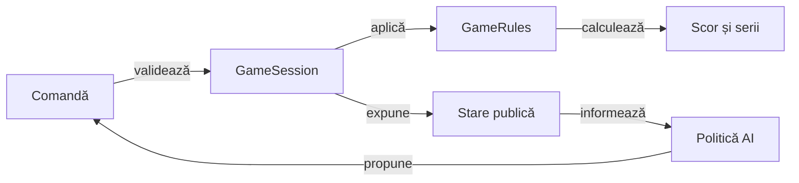

# Motorul de reguli Whist

## Pe scurt

Bibliotecă Java fără dependență de Android. Același motor este consumat de
aplicație și de testele JVM; verificările independente ale testelor nu trebuie
să împrumute verdictul motorului verificat.

## Fluxul domeniului



<details>
<summary>Legendă și limite</summary>

Regulile filtrează toate acțiunile, inclusiv cele propuse de AI. Starea capturată furnizată politicii conține mâna actorului și faptele publice; istoricul scorului aparține domeniului, nu geometriei Android.

</details>

## Contracte în cod

| Sursă | Contract |
|---|---|
| [GameConfig](src/main/java/ro/whistlab/core/GameConfig.java) | Număr de jucători, variantă, nivel, valoare de inițializare și configurarea seriilor. |
| [GameMode](src/main/java/ro/whistlab/core/GameMode.java) | Variante distincte și alegerea profilului românesc. |
| [GameRules](src/main/java/ro/whistlab/core/GameRules.java) | Pachet, program, oferte legale, cărți legale, câștigător și scor de bază. |
| [RomanianScoring](src/main/java/ro/whistlab/core/RomanianScoring.java) | Punctele contractului, bonusul de serie și contorul următor. |
| [GameSession](src/main/java/ro/whistlab/core/GameSession.java) | Tranzițiile sesiunii, istoricul public și validarea restaurării. |
| [ScoreHistory](src/main/java/ro/whistlab/core/ScoreHistory.java) | Licitațiile pe locuri, punctele mâinii și totalurile după fiecare mână încheiată. Salvările vechi păstrează numai informația cunoscută. |
| [HowToPlay](src/main/java/ro/whistlab/core/HowToPlay.java) | Regulile și programul afișate în română și engleză. |

## Whist românesc

Profilul acceptă 3–6 jucători și un pachet redus de `8 × N` cărți mari.

Pentru `ROMANIAN_WHIST`, programul este `N` mâini de o carte, 2…7, `N` mâini de opt, 7…2 și `N` mâini de o carte. `LONG_ROMANIAN` are propriul program; nu se suprapune implicit peste primul profil. Programele tuturor variantelor sunt calculate de `GameRules.handSizes`.

Licitarea și prima levată pornesc după dealer. Oferta este între zero și mărimea
mâinii; ultima ofertă care ar face suma egală cu numărul de levate este interzisă.
Dealerul avansează la mâna următoare.

Jucătorul urmează culoarea cerută dacă o are.

- Dacă nu o are, dar deține atu, taie obligatoriu; în lipsa ambelor poate decarta.
- Supratăierea nu este obligatorie.
- Câștigă cel mai mare atu sau cea mai mare carte din culoarea cerută.
- Câștigătorul conduce următoarea levată.
- Atuul românesc este indicat de o carte neîmpărțită, întoarsă; mâinile de opt cărți sunt fără atu.

Contractul exact acordă `5 + levate`; ratarea acordă `-abs(levate - contract)`.

- Seriile sunt opționale și se aplică variantelor românești.
- După cinci contracte exacte eligibile se acordă +5 sau +10; după cinci ratări se scad 5 puncte, apoi contorul se resetează.
- O mână de o carte nu avansează seria, dar rezultatul opus o întrerupe.
- Contractul zero exact este un succes.
- Constructorul `GameConfig` cu patru argumente păstrează profilul fără serii; constructorii și validările explicite definesc celelalte valori implicite.

Oh Hell și celelalte variante folosesc profilul lor de pachet, program, atu și scor.

De exemplu, obligația de a tăia din profilul românesc nu se transferă automat în Oh Hell. Alegeți întotdeauna `GameMode` în datele de test și în scenariu.

## Sesiune și salvare

O comandă ilegală este respinsă înainte de modificarea stării. Scorul și soldul
de închidere se aplică după ultima carte a mâinii. `ScoreHistory` permite doar
avansarea cu o mână; punctele unei mâini sunt diferența dintre două solduri,
inclusiv punctele seriei.

`GameSession.restoreComplete` cere istoricul public complet.

Restaurarea de compatibilitate poate accepta o salvare veche cu istoric limitat și păstrează originea cunoscută a scorului. Ea nu justifică inventarea unor cărți sau scoruri anterioare. Schema JSON Android este responsabilitatea [GameSessionStore](../app/src/main/java/ro/whistlab/app/GameSessionStore.java).

## AI și componente

[AiDifficulty](src/main/java/ro/whistlab/core/AiDifficulty.java) expune Normal și Hard.

- `EXPERT` este un alias de compatibilitate, migrat la Hard la citirea unei salvări vechi.
- [AiPolicy](src/main/java/ro/whistlab/core/AiPolicy.java) alege politica activă pentru nivelul configurat.
- Politicile primesc o observație izolată: mâna proprie, licitațiile, levatele câștigate, masa și istoricul public. Nu primesc listele de cărți ale celorlalți jucători.
- Hard folosește ofertele publice drept ținte de contract în simulări și exclude cărțile deja jucate și atuul întors din pachetul necunoscut; împărțirea necunoscută nu este încă ponderată cu probabilitatea ca acel loc să fi făcut oferta observată. Acesta este un candidat separat de cercetare, nu o capabilitate deja implementată.
- Estimările probabilistice și garzile de final cu domeniu finit nu demonstrează joc perfect cu informație ascunsă.
- Codul experimental extern nu este activat automat.

Testele de reguli, sesiune, scor, punct de control și AI se găsesc în
[src/test/java](src/test/java/ro/whistlab/core/). Cazurile cu rezultat așteptat demonstrabil pe un domeniu finit trebuie
să aibă un oracol separat sau un invariant justificat; o mutare istorică a
câștigătorului nu este singură un rezultat așteptat corect.

## Rulare offline

Dintr-o copie proprie din `%TEMP%` a `whist-lab-app`:

```powershell
.\gradlew.bat -p algorithm-build :game-core:quickRegressionTest --offline --no-daemon
.\gradlew.bat -p algorithm-build :game-core:regressionTest --offline --no-daemon
.\gradlew.bat -p algorithm-build :game-core:contextRegressionTest --offline --no-daemon
```

[configurația Gradle](build.gradle) definește selecțiile efective și excluderile testului implicit.

- `quick` este o selecție, nu o populație care se adună la regresia completă.
- Colecția `context` urmărește finaluri mici cu martori legali independenți.
- `documentation` verifică regulile afișate; `strategy` și `research` au scopuri distincte.
- Turneele `learning` și `arena` se activează explicit, cu identitate de candidat și protocol, nu prin testul implicit.

[Catalogul colecțiilor](../../config/test-collections.json) și
[lansatorul](../../scripts/run-whist-collection.ps1) sunt sursele selecției și
parametrilor actuali. Rezultatele XML native și datele de comparație se păstrează în
directorul extern al execuției. Un rezultat JVM nu reprezintă o execuție Android.

## Politica Normal și Hard

[Manifestul regulilor de joc](../../config/whist-play-objectives.yaml) fixează obiectivele observabile pentru cele două niveluri.

| Politică sau stare | Prioritate |
|---|---|
| Normal înaintea contractului | Caută levatele necesare și păstrează oportunități pentru cele viitoare. |
| Normal după contract | Evită levatele suplimentare în limitele legalității. |
| Hard cu contract recuperabil | Șansa exactului, punctele proprii și departajarea prin scorul rivalului principal. |
| Hard cu imposibilitate dovedită public | Punctele proprii estimate, apoi ratările adverse estimate și scorul rivalului principal. |
| Certificat complet | Înlocuiește estimarea numai cu protecția punctelor proprii în toate lumile și continuările relevante. |

Domeniul și bugetul certificatului sunt definite de implementare; epuizarea bugetului păstrează propunerea de bază.

## Simulare și îmbunătățire offline

| Mecanism | Intrare controlată | Scop |
|---|---|---|
| `run-offline-policy-match.ps1` | Valoare de inițializare și politici explicite | Partidă completă pentru diagnostic și verificarea tranzițiilor. |
| `run-offline-perspectives.ps1` | Aceeași distribuție, locuri rotite | Sensibilitatea rezultatului la poziția politicii evaluate. |
| `run-offline-strategy-profiles.ps1` | Aceleași distribuții și alternative de decizie | Comparații pereche între politici candidate și politica de bază. |
| `run-whist-collection.ps1` | Colecție, protocol și candidat | Componente, regresie sau calificare controlată a unei politici. |

Parametrii și profilurile experimentale sunt definite în lansator și protocol; documentația nu fixează inventarul unui lot sau rezultatele lui. Datele jocurilor rămân în arhiva externă, iar regresia de componentă păstrează doar cazuri minime cu așteptare justificată independent.

După schimbarea unei licitații sau cărți, stările publice ulterioare pot diverge. Comparația pereche păstrează distribuția și locul, iar analiza locală reconstruiește prima decizie divergentă folosind numai informația disponibilă actorului.

[Arhitectura învățării](../../docs/AI_LEARNING_ARCHITECTURE.md) și [protocolul](../../docs/AI_TRAINING_PROTOCOL.md) definesc separarea dezvoltării de evaluare și criteriile promovării.
