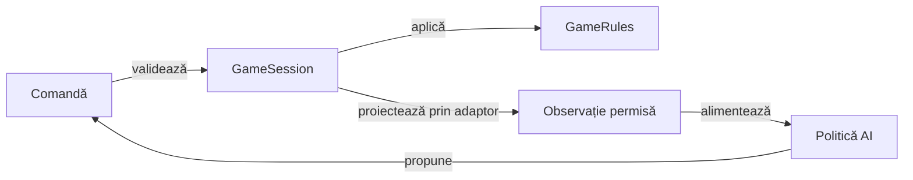

# Motorul de reguli Whist

## Pe scurt

Motorul Java deține configurarea, regulile, tranzițiile, istoricul scorului și politica de joc. Aplicația Android și mediul JVM consumă aceleași surse; producția rămâne independentă de Android, ATF și JUnit.

Testele verifică domeniul prin proprietăți și oracole independente. [Intrarea JVM](../algorithm-build/README.md) permite lucrul offline, iar [ghidul variantelor](../../docs/game/README.md) deține explicația completă a regulilor.

- [Laboratorul AI](../ai-lab/README.md) este dependență Gradle numai pentru teste. Politica independentă se compilează în modulul ei; distribuția motorului păstrează doar sursele de producție proprii.

## Fluxul domeniului



<details>
<summary>Legendă: starea sesiunii și observația actorului</summary>

Sesiunea păstrează starea completă necesară jocului și restaurării. Fațada [AiPolicy](src/main/java/ro/whistlab/core/ai/policy/AiPolicy.java) construiește observația politicii prin adaptoarele de observare: mâna proprie și informația publică. Distribuția completă folosită de sesiune și audit nu devine intrare în algoritmul deciziei.

</details>

## Contracte în cod

| Zonă | Responsabilitate |
|---|---|
| [GameConfig](src/main/java/ro/whistlab/core/config/GameConfig.java) | Număr de jucători, variantă, nivel, inițializare și configurarea seriilor. |
| [GameRules](src/main/java/ro/whistlab/core/rules/GameRules.java) | Pachet, program, oferte și cărți legale, câștigător și scor de bază. |
| [RomanianScoring](src/main/java/ro/whistlab/core/rules/RomanianScoring.java) | Punctele contractului și evoluția seriilor. |
| [GameSession](src/main/java/ro/whistlab/core/session/GameSession.java) | Fazele, comenzile, istoricul public și validarea restaurării. |
| [ScoreHistory](src/main/java/ro/whistlab/core/session/ScoreHistory.java) | Licitațiile cunoscute și soldurile mâinilor încheiate; punctele sunt diferența dintre solduri. |
| [HowToPlay](src/main/java/ro/whistlab/core/rules/HowToPlay.java) | Ajutorul RO/EN pentru profilul și programul selectate. |

## Whist românesc

Profilul acceptă 3–6 jucători și un pachet redus de `8 × N` cărți mari. [GameMode](src/main/java/ro/whistlab/core/rules/GameMode.java) selectează varianta, iar `GameRules.handSizes` definește programul; variantele cu nume apropiate păstrează contracte distincte.

- Se urmează culoarea cerută; în lipsa ei, atuul este obligatoriu dacă există în mână. Supratăierea nu este obligatorie.
- Câștigă cel mai mare atu sau cea mai mare carte din culoarea cerută; câștigătorul conduce levata următoare.
- Licitația este în intervalul mâinii, iar ultima ofertă nu poate egaliza suma cu numărul de levate.
- Contractul exact acordă `5 + levate`; ratarea scade diferența absolută.
- Seriile opționale folosesc valorile explicite din GameConfig. `newMatch` aplică simetric 5 sau 10, iar constructorul de compatibilitate care primește numai bonusul pozitiv păstrează penalizarea istorică de 5; eligibilitatea și întreruperea sunt definite de `RomanianScoring`.

[Regulile RO/EN](../../docs/game/README.md) explică distribuirea, atuul, programul și seriile. Configurația este explicită: constructorul de compatibilitate cu patru argumente păstrează seriile dezactivate, iar celelalte forme își validează opțiunile.

## Sesiune și salvare

O comandă ilegală este respinsă înaintea tranziției. Închiderea mâinii aplică scorul și înregistrează soldul; `ScoreHistory` avansează câte o mână și păstrează informația cunoscută.

- `restoreComplete` cere istoricul public complet. Restaurarea de compatibilitate păstrează originea cunoscută a scorului; [contractul istoricului](../../docs/game/ATF_ScoreHistory.md) precizează datele care lipsesc din salvările vechi și limita levatelor istorice.
- Schema JSON Android aparține [GameSessionStore](../app/src/main/java/ro/whistlab/app/persistence/GameSessionStore.java). Validarea domeniului și serializarea Android au responsabilități și teste distincte.

## Politica Normal și Hard

[AiDifficulty](src/main/java/ro/whistlab/core/config/AiDifficulty.java) expune cele două niveluri și aliasul de compatibilitate pentru salvări vechi. Fațada `AiPolicy` selectează politica și izolează observația înaintea calculului.

- **Normal** urmărește contractul și evită levatele suplimentare după realizarea lui, în limitele acțiunilor legale.
- **Hard** compară continuări pe lumi compatibile cu informația publică, necesarul și contractele cunoscute; [MonteCarloAi](src/main/java/ro/whistlab/core/ai/engine/MonteCarloAi.java) deține compoziția deciziei.
- Certificatele finite și recuperarea contractelor imposibile au condiții și bugete explicite; epuizarea unui buget păstrează propunerea de bază.

[SearchCancellation](src/main/java/ro/whistlab/core/ai/simulation/SearchCancellation.java) verifică întreruperea la frontierele eșantionării, simulării și căutării finite. Anularea abandonează calculul și păstrează marcajul întreruperii; proprietarul turei invalidează rezultatul, iar epuizarea unui buget de certificat își păstrează separat comportamentul de rezervă.

[Modelul deciziei](../../docs/ai/ATF_DecisionModel.md) și [regulile configurabile](../../docs/ai/ATF_RulesConfiguration.md) delimitează comportamentul activ de ipotezele de cercetare. Estimarea probabilistă și un certificat local nu garantează câștigarea fiecărei partide cu informație ascunsă.

## Rulare offline

Din rădăcina proiectului, [lansatorul](../../scripts/run-whist-collection.ps1) pregătește copia temporară și păstrează rezultatele extern:

```powershell
.\scripts\run-whist-collection.ps1 -Collection quick
.\scripts\run-whist-collection.ps1 -Collection context
```

[Configurația Gradle](build.gradle) și [catalogul colecțiilor](../../config/test-collections.json) definesc selecțiile. `regression` execută sarcina de regresie cu excluderile declarate, iar `documentation` verifică ajutorul de joc; învățarea, arena și cercetarea se aleg explicit.

Dintr-o copie temporară proprie a `whist-lab-app`, intrarea directă este:

```powershell
.\gradlew.bat -p algorithm-build :game-core:quickRegressionTest --offline --no-daemon
```

[Arhitectura testării](../../docs/testing/ATF_Architecture.md) delimitează componentele, integrarea și Android. [Învățarea offline](../../docs/learning/README.md) explică extragerea regresiilor mici, comparațiile pe aceleași distribuții și calificarea pe partide noi.

## Îmbunătățiri prioritare ale motorului

Separarea domeniului de Android este solidă; următoarea limită este calificarea costului și a deciziei probabiliste. Responsabilul motorului păstrează comportamentul și sursele politicilor de referință în timpul extragerilor.

| Prioritate | Cerință | Criteriu de închidere |
|---|---|---|
| P1 | Definiți bugetul operațional al Hard. | Contexte publice controlate pentru 2–8 cărți verifică numărul de lumi, epuizarea căutării, anularea și alegerea legală de rezervă; măsurătorile identifică mediul și distribuția costului. |
| P2 | Delimitați în continuare evaluarea alternativelor de compoziția deciziei. | Extragerile din MonteCarloAi păstrează ordinea eșantionării, inițializarea deterministă și așteptări independente; dimensiunea clasei este indiciu, iar contractul mecanismului justifică separarea. |
| P2 | Calificați frontierele critice prin mutanți semantici. | Inversarea obligației de atu, a câștigătorului sau a întreruperii seriei este detectată de un control independent; configurația JaCoCo publică acoperirea, fără a o trata drept dovadă a corectitudinii. |

[Criteriile AI](../../docs/feedback/ATF_Ai.md) dețin calificarea strategică. [Regulile documentației](../../docs/governance/ATF_Documentation.md) cer aceeași descriere a profilului nou și a compatibilității în toate rezumatele.
