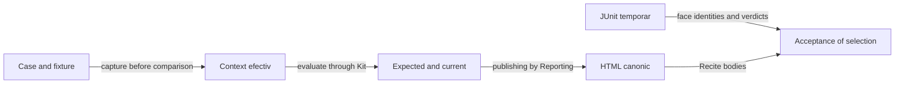

# Audit of Gradle components

## Overview

JVM module exclusively for test fixtures. JUnit Bridge 4 captures the actual context and comparisons through the joint and public kit through the physical reporting library. The application and the graphical AARs do not depend on this variant.

## The number of the selected sample shall be determined by the manufacturer.

Legend: execution and publication

A JUnit rule holds the claim, including fixtures before/after. The duration of this statement shall be measured prior to publication. Gradle temporarily retains the XMLs for independent counting; delivery retains an HTML for each selection after accurate confrontation.

## Contracts

- The context shall be captured at execution before the first comparison, including parametric values and local fixtures. Source code does not replace the observed values.
- JUnit 4 keeps runners and parametrizations; the deck adapts the order of the assertions message to Kit.
- The lack of context, lack of comparison, omission of an appeal, duplication or divergent verdict prevents acceptance.
- The declared rasters are PNG inline, labelled as JVM fixture. No Android catches.
- The catalogue classifies units, components, governance and learning; learning selections remain eighty-in.
- One worker and one HTML per task avoid unqualified competition; the closureur and final check belong to the selection.

## Rulare

Gradle test task automatically applies the deck. `whist.auditOutput` chooses the report director and `whist.auditSource` fixes the identity of the source inventory for qualification. The final check confronts HTML with the original JUNIT and the library inspector; the mere existence of the file is not acceptable.

The versions of the kit and the reporting are read from `atf.testkit.version` and `atf.reporting.version` of the root POM. The configuration refuses local pairs JAR/POM absent or with divergent coordinates; does not duplicate versions and does not choose Routing by lexical sorting in the Gradle building.
