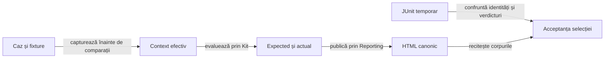

# Auditul componentelor Gradle

## Pe scurt

Modul JVM exclusiv pentru fixture-uri de testare. Puntea JUnit 4 capturează contextul efectiv și comparațiile prin Kitul comun și publică prin biblioteca Reporting fizică. Aplicația și AAR-ul grafic nu depind de această variantă.

## Fluxul unei selecții

Legendă: execuție și publicare

O regulă JUnit deține invocarea, inclusiv fixture-urile before/after. Durata acestui statement se măsoară înaintea publicării. Gradle păstrează temporar XML-ul pentru numărare independentă; livrarea reține un HTML pentru fiecare selecție, după confruntarea exactă.

## Contracte

- Contextul se capturează la execuție, înaintea primei comparații, inclusiv valorile parametrizate și fixture-urile locale. Codul sursă nu înlocuiește valorile observate.
- JUnit 4 păstrează runner-ele și parametrizările; puntea adaptează ordinea mesajului aserțiunilor către Kit.
- Lipsa contextului, lipsa comparațiilor, omisiunea unei invocări, duplicarea sau verdictul divergent împiedică acceptarea.
- Rasterele declarate sunt PNG inline, etichetate drept fixture JVM. Nu reprezintă capturi Android.
- Catalogul clasifică unități, componente, guvernanță și învățare; selecțiile de învățare rămân opt-in.
- Câte un worker și un HTML per task evită concurența necalificată; closure-ul și verificarea finală aparțin selecției.

## Rulare

Task-urile Gradle de testare aplică automat puntea. `whist.auditOutput` alege directorul rapoartelor, iar `whist.auditSource` fixează identitatea inventarului sursei pentru calificare. Verificarea finală confruntă HTML-ul cu JUnit-ul original și cu inspectorul bibliotecii; simpla existență a fișierului nu este acceptanță.
